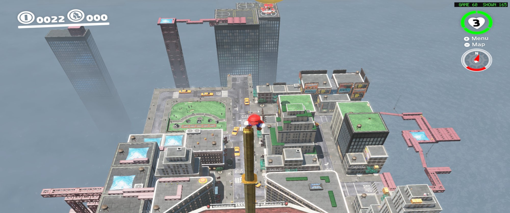

# smo-recomp

*Super Mario Odyssey* running natively on Windows: the Nintendo Switch game's code translated ahead of time to C and
compiled for the PC, with its own runtime and a Vulkan renderer. Not an emulator: no CPU interpreter, no JIT, no
console firmware.



*New Donk City at 2560x1440 (RTX 3090, Ryzen 5 3600XT): the game at 60 fps, shown at the monitor's 165 Hz with
frame interpolation.*

> **No game code, assets, keys or firmware are in this repository.** You need your own copy of the game, dumped from
> your own console. Everything made from your dump stays on your PC, under `build/`.

This is a fork of [Coz-0/smo-recomp](https://github.com/Coz-0/smo-recomp). It adds the **1.3.0** update, **frame
interpolation** (120 fps or one picture per refresh of your monitor, NVIDIA RTX 30 and later), **higher internal
resolutions** (1080p, 1440p, 4K), a **launcher** with these options, a **shake button** for pads without motion
sensors, and a lot of **speed**: New Donk City's streets went from about 20 fps to a steady 60 on a 6-core Zen 2.
Details: [What this fork changes](#what-this-fork-changes).

## Contents

- [What you need](#what-you-need)
- [Build](#build)
- [Play](#play)
- [Performance](#performance)
- [What this fork changes](#what-this-fork-changes)
- [Switches for testing](#switches-for-testing)
- [How it works](#how-it-works)
- [Status of the game](#status-of-the-game)
- [Legal](#legal) and [Credits](#credits)

## What you need

- **Windows 10/11 x64** and a **Vulkan 1.3 GPU**. Developed on NVIDIA (RTX 3090, RTX 4090). Frame interpolation needs an
  NVIDIA RTX 30 series or later (`VK_NV_optical_flow`).
- **Your own dump of the game**, version **1.3.0 or 1.4.1**, made on your console with a dumper that writes decrypted
  files (nxdumptool), laid out in one folder:
  ```
  <dump>\
    exefs\          the program's ExeFS with the update: main, main.npdm, sdk, rtld, subsdk0
    romfs\          the RomFS with the update applied (about 5.7 GB; keep it on a fast drive)
    control.nacp    the update's control data (its version is checked)
    manual\         optional: the Help pages (html-document\...)
    fonts\          optional: the console's shared fonts (.bfttf)
  ```
- **Tools:**
  - Python 3.13 (`py -3.13`)
  - LLVM/clang **9.0.0** exactly ([releases.llvm.org/9.0.0](https://releases.llvm.org/9.0.0/);
    `7z x LLVM-9.0.0-win64.exe -oC:\llvm-9.0.0` unpacks it without installing; else set `LLVM_ROOT`)
  - Visual Studio Build Tools with the C++ workload and a Windows 10/11 SDK
  - the [Vulkan SDK](https://vulkan.lunarg.com/) 1.4 (not under `C:\VulkanSDK`? set `VULKAN_HEADERS` to its `Include`)
  - SDL3 3.4.18: unzip `SDL3-devel-3.4.18-VC.zip` (SDL releases on GitHub) into `deps\SDL3-3.4.18`
  - the WebView2 SDK: unzip `https://www.nuget.org/api/v2/package/Microsoft.Web.WebView2/1.0.2903.40` (a `.nupkg` is a
    zip) into `deps\webview2-1.0.2903.40`

## Build

```bat
py -3.13 -m venv .venv
.venv\Scripts\python -m pip install lz4 capstone unicorn numpy Pillow
.venv\Scripts\python scripts\setup.py --only deps
.venv\Scripts\python scripts\setup.py --dump "<dump>"
```

- `--only deps` names anything missing.
- The first build takes about 6 minutes (Ryzen 5 3600XT); later runs only redo what changed, and after a change to
  the runtime alone `--only link` is enough.
- Optional, faster on your CPU (the build then runs on that CPU family and newer only): `set
  RECOMP_ARCH=-march=znver2 -mno-prfchw` (Zen 2; `-march=native` for the CPU that builds) before `setup.py`.

## Play

Double-click **`play.bat`** (or run `.venv\Scripts\pythonw scripts\launcher.py`).

The launcher sets the picture and window options, then starts the game:

| Option | Choices |
|---|---|
| Rendering resolution | 720p, 900p (the game's own), 1080p, 1440p, 4K, or your monitor's height |
| Display | borderless fullscreen, or a borderless window of 1280x720 to 2560x1440 |
| Frame interpolation (NVIDIA) | off, x2 (120 fps), x3, x4, or **Écran**: one picture per refresh of your monitor |
| FPS counter | top right: `GAME` = the game's frames a second, `SHOWN` = pictures shown |
| Anisotropic filtering 16x | sharper ground textures at a slant |

The game is 16:9: on a wider monitor it has black bars on the sides. Without the launcher:
`.venv\Scripts\python scripts\run.py play --exe smo_native.exe --seconds 0`.

**Controls:** any pad through SDL3 (Xbox, PlayStation, Switch Pro; hot-plug, up to 8 players, rumble, motion) or the
keyboard. Remapping in `build\config\controllers.ini`.

| Key / button | What it does |
|---|---|
| **R1 / RB** | shakes the controller (spin throws, Cappy's shake moves) for pads without motion sensors; `shake_pad` in `controllers.ini` |
| F11, or double-click | fullscreen and back |
| F12, or the pad's share button | saves the frame to the save folder's `album` (and, when started from the launcher, a capture of the frame's render passes for bug reports) |
| F1, or both stick buttons | the amiibo menu (102 amiibo) |

**Files:** saves in `build\userdata\save` (`Common.bin`, `File1.bin`: put an existing save there to use it); settings
in `build\config\graphics.ini` and `controllers.ini`; the log of the last session in `build\run\play.log`. The first
visit of each place compiles its shaders; they are kept in `build\cache`.

## Performance

Ryzen 5 3600XT (6 cores) and RTX 3090, New Donk City's streets (about 2,000 draws a frame, the heaviest place found):

| | fps there |
|---|---|
| as forked | about 20 |
| this fork, the game's own 1600x900 | 59-60 |
| this fork, 2560x1440 with frame interpolation | 59-60 (shown at the monitor's refresh) |

What made the difference, biggest first:

- **The game's sampler table search in host code.** The game looks for a free slot in its sampler table one call per
  slot, and the table is nearly full: about 88,000 calls a frame on the game's main thread. They are now answered in
  one step (main thread 12 → 7 ms a frame).
- **Vertex and index data read in place.** The game's 3 GB heap is imported into Vulkan once at start
  (`VK_EXT_external_memory_host`), so the GPU reads the game's meshes where they are instead of a copy of 17 MB a frame.
- **The render thread no longer waits for the game:** the game draws its next frame while this one is turned into
  Vulkan commands; a clock for the game's GPU timestamps that keeps its dynamic resolution at full size.
- **`-O2` and a CPU-specific build** of the translated code, many small caches in the renderer (pipelines, samplers,
  texture sets, dynamic state), no waits for the GPU's occlusion results.

Still to do: shorter stalls the first time a place loads (textures made then), and the render thread itself (about
11 ms a frame in the city; [docs/plan-render-replay.md](docs/plan-render-replay.md) lists the next steps).

## What this fork changes

- **Version 1.3.0** accepted beside 1.4.1 (same NintendoSDK 7.3.2 program; the base game's ExeFS is not needed).
- **Frame interpolation** (`runtime/gfx/nvn_vk_interp.c`): the GPU's optical flow engine measures the motion between the
  game's frames (on a copy at most 900 lines high, so a 1440p picture costs no more), a compute stage makes the frames
  between, a presenter thread with its own queue shows them. When the game's next frame is late, the newest frame is
  moved on along its motion instead. Modes: x2..x6, or one picture per monitor refresh (`frame_interpolation_multiplier
  = display`, experimental).
- **Internal resolution above the game's** (`resolution_scale` up to 3.0: 1.2 = 1080p, 1.6 = 1440p, 2.4 = 4K): the CPU
  does the same work, only the GPU draws more pixels.
- **Fixes:** a white screen in New Donk City (the bloom's downsample read the mip level it was drawing into, and that
  loop grew until everything was white); colours with banding where the game's sampler table is full; a shader cache
  that was never written on a fresh build; the runtime's own threads kept off the game's processors.
- **The launcher** (`scripts/launcher.py`) and the **shake button**.
- **Speed**: see [Performance](#performance).

## Ideas for later

Picture:
- **Anti-aliasing**: the game has almost none. Supersampling already works (render at 4K, `resolution_scale = 2.4`,
  shown at the window's size); a cheaper SMAA / FXAA pass would help weaker GPUs.
- **Ultrawide (21:9)**: the game's camera aspect ratio patched and its HUD kept in place, instead of black bars.
- **Draw distance**: the game's level-of-detail distances raised, so far buildings and objects keep their full models.
- **Sharper shadows**: the shadow maps made at a higher resolution, as the screen's targets already are.

Smoothness:
- **No first-visit stutter**: every shader and pipeline of the game made at start, not when a kingdom is first entered.
- **Faster loading**: the loading screens profiled (file reads and decompression look single-threaded).
- **More headroom**: the render thread's per-draw work ([docs/plan-render-replay.md](docs/plan-render-replay.md)), then
  the lifter keeping guest registers in C locals (measured on samples: 15-30% less time on the game's threads).

Features:
- **A mod folder** (LayeredFS): files in a folder override the game's (textures, outfits, other mods).
- **Photo mode extras**: HUD off on a key, free camera.
- **Linux / Steam Deck** build.

## Switches for testing

Environment variables, mostly to turn a change off when looking for the cause of a problem:

| Variable | Default | What it does |
|---|---|---|
| `SMO_VK_INTERP` | from `graphics.ini` | frame interpolation on (1) or off (0) |
| `SMO_VK_INTERP_MULT` | from `graphics.ini` | 2..6, or `display` |
| `SMO_VK_SCALE` | from `graphics.ini` | internal resolution scale |
| `SMO_VK_HOSTMEM` | 1 | 0: copy vertex and index data every frame, as before |
| `SMO_FAST_SKIP` | 1 | 0: the sampler table search one call per slot, as the game does it |
| `SMO_VK_OCC_LATE` | 1 | 0: wait for the GPU's occlusion results |
| `SMO_VK_FEEDBACK_LEVELS` | 1 | 0: a texture drawn into keeps every mip level in the view sampled |
| `SMO_VK_SMP_ZERO` | 1 | 0: an unknown sampler ID gets the old default sampler |
| `SMO_HITCH` | off | `=40`: the log explains every frame longer than 40 ms |

[docs/debugging.md](docs/debugging.md) lists the rest.

## How it works

1. **Import.** `scripts/setup.py` reads your dump in place and converts the program's modules to ELF.
2. **Function list.** Every function of the executable (54,214 in `main`), from its own unwind tables.
3. **Translation.** `tools/lifter/recomp.py` turns each AArch64 function into a C function; clang compiles them into a
   DLL. A differential test against the Unicorn emulator: 23,194 of 23,194 sampled instructions equal.
4. **Runtime.** `runtime/` stands in for the console: the three-core thread scheduling, files and journalled saves,
   the NVN graphics API on Vulkan with a translator of the GPU's shader machine code, the audio renderer, controllers,
   videos, the Help pages and the offline system services.

[docs/architecture.md](docs/architecture.md) explains each part. Layout of the repository:

```
runtime/   the host runtime: core, libc, os, fs, gfx, audio, input, services, game
scripts/   setup.py (dump to build), run.py (start the game), launcher.py (options, then play)
tools/     the import of your dump, the lifter and build steps, debugging lookups
tests/     scripted Cap Kingdom run, stage stress test, shader and texture checks
docs/      building, architecture, debugging, scripted runs, the renderer's plan
```

## Status of the game

- **Plays** from the title screen through the kingdoms tried by hand (Cap, Cascade, Sand, Wooded, Metro, ...), with
  saves, autosave, videos, Help, amiibo and sound.
- **Tested by scripts:** `tests/run_cap_kingdom.py` plays from an empty save to Mario's first capture and checks 14
  checkpoints against the game's own state (passes); `tests/stress_stages.py` started every stage and every scenario
  of every kingdom (276 runs, 0 failures); every shader of the game translates and compiles (27,888 of 27,888).
- **Not available:** online services; not tried: what 1.4.1 adds (Balloon World, the new Snapshot Mode filters, Labo
  VR).

## Contributing

Testers with other GPUs and controllers are welcome. Read [CONTRIBUTING.md](CONTRIBUTING.md) first: nothing derived
from the game goes into the repository.

## Legal

This project is not affiliated with, endorsed or sponsored by Nintendo. *Super Mario Odyssey* and *Nintendo Switch*
are trademarks of Nintendo and are named only to say what the software works with. The repository contains only
original source code and documentation (GPL-3.0-or-later, see [LICENSE](LICENSE)) and one screenshot of the program
running: no game code, binaries, assets, console keys or firmware, and it does not help anyone obtain them. You must
own the game and dump it yourself.

## Credits

- [Coz-0/smo-recomp](https://github.com/Coz-0/smo-recomp): the project this fork is based on.
- [ssbu-recomp](https://github.com/Denkishi/ssbu-recomp) by Denkishi: the design, lifter and runtime it started from.
- [OdysseyDecomp](https://github.com/MonsterDruide1/OdysseyDecomp), read as a reference only; yuzu/suyu and Ryujinx
  documentation, cited where used.
- [Unicorn](https://www.unicorn-engine.org/), [Capstone](https://www.capstone-engine.org/),
  [SDL3](https://github.com/libsdl-org/SDL), [glslang/shaderc](https://github.com/KhronosGroup/glslang), the Vulkan SDK.
